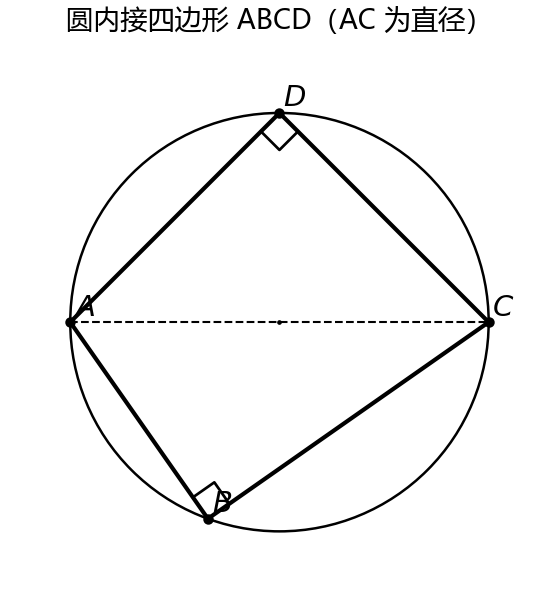
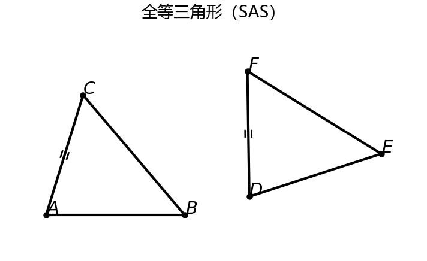

# 📐 初中数学 RAG 智能问答与家教系统

> 面向初中数学的检索增强生成（RAG）问答系统：支持「知识点问答 / 生成练习题 / 整理错题」三种模式，
> 并能根据几何题**自动生成几何准确的配图**，公式自动转换为可读的 Unicode 符号。

## ✨ 功能特性

- **三种对话模式**
  - 知识点问答：基于检索到的教材/结论回答，标注易错点
  - 生成练习题：贴合中考难度出题，附参考解答
  - 整理错题：按知识点整理高频易错题型
- **中文混合检索**：BM25 关键词检索 + 向量检索（Qdrant）+ RRF 融合 + 重排序（bge-reranker）
- **引用溯源**：回答时展示检索到的参考片段
- **几何图自动生成**：大模型把几何题解析成结构化 JSON（顶点、边、直径、直角等），再由 `matplotlib` **确定性渲染**，保证图形几何关系真实成立（圆内接四边形、全等三角形等）
- **公式友好**：LaTeX → Unicode 转换（`\angle`→∠、`\odot`→⊙、`\frac`→`/` 等），不依赖任何公式渲染器也能正常显示
- **多轮对话**：保留上下文，支持历史记录

## 📸 效果展示

几何图由渲染器确定性生成（非 AI 文生图），标注与几何关系准确：

| 圆内接四边形（AC 为直径） | 全等三角形（SAS） |
|:---:|:---:|
|  |  |

## 🧠 核心设计：几何图为什么不用文生图？

文生图模型画几何图会画错标注、比例失真（"全等三角形"画出来并不全等）。
本项目改为：

```
LLM 输出结构化几何 JSON（点/边/直径/直角）
        ↓
Python 用 matplotlib 精确计算坐标、确定性绘制
        ↓
输出 PNG（字母、比例、全等/垂直关系 100% 正确）
```

例如「圆内接四边形 ABCD，AC 为直径」会被解析为：

```json
{"type":"cyclic_quadrilateral","labels":["A","B","C","D"],"diameter":["A","C"]}
```

渲染器据此把 A、C 放成对径点，并在 B、D 处标出真实的 90° 直角。

## 🛠 技术栈

| 层 | 技术 |
|---|---|
| 交互界面 | Gradio |
| 大模型 | DeepSeek（deepseek-chat） |
| 向量检索 | Qdrant + BAAI/bge-small-zh-v1.5 |
| 重排序 | BAAI/bge-reranker-base（FlagEmbedding） |
| 关键词检索 | rank-bm25 |
| 几何绘图 | matplotlib |
| 公式转换 | 自研 LaTeX → Unicode |

## 📁 目录结构

```
backend/
  chat_rag.py          # 数学家教助手（Gradio 主程序）
  geometry_render.py   # 确定性几何图渲染（圆内接四边形/三角形等）
  math_unicode.py      # LaTeX → Unicode 公式转换
  app/                 # 原始 FastAPI RAG 引擎（检索/解析/LLM 抽象）
  requirements.txt
frontend/              # 原始 React 前端（FastAPI 那套）
```

## 🚀 快速开始

```bash
cd backend

# 1) 安装依赖
pip install -r requirements.txt
pip install gradio qdrant-client FlagEmbedding matplotlib

# 2) 配置大模型 Key（不要写进代码）
#    在 backend/.env 写入：
#    DEEPSEEK_API_KEY=sk-你的key

# 3) 启动
python chat_rag.py
```

浏览器打开 <http://127.0.0.1:7860>，选择模式后提问即可。

> 首次运行会自动加载 `bge-small-zh-v1.5` 与 `bge-reranker-base` 模型（已缓存则直接读本地）。

## 🔒 安全说明

- 真实 API Key 请放在 `backend/.env`（已在 `.gitignore` 中，不会被提交）；
- 模型缓存、向量库（`qdrant_db/`、`chroma_db/`）、生成图片（`generated_figures/`）等大文件均已排除。

## 📄 说明

本项目基于 MIT 协议的 [lyakoway/ai-RAG-chat](https://github.com/lyakoway/ai-RAG-chat) 二次开发，
在其通用 RAG 引擎基础上增加了「初中数学家教」场景、几何图确定性渲染与公式 Unicode 化能力。
